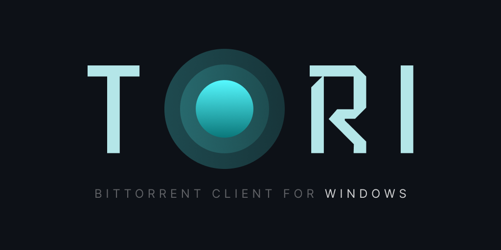
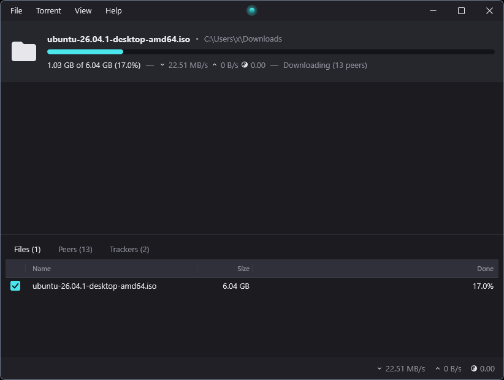

<p align="center">
    
</p>

---

**Tori** is an open source BitTorrent client for Windows written in C++. It implements its own BitTorrent API and
utilizes [XenUI](https://github.com/jakerieger/XenUI) for the GUI.



## Releases

Pre-compiled binaries of Tori are available from the [releases](https://github.com/jakerieger/Tori/releases/latest)
section of this repo.

## Building

### Requirements

- Windows 10 version 1903 or later, x64
- Visual Studio 2022 or later with the **Desktop development with C++** workload (MSVC and the Windows SDK)
- CMake 3.26 or later and Ninja (both ship with Visual Studio)

### Build steps

Run these from an **x64 Developer Command Prompt for VS**, or any shell where `vcvars64.bat` has been run:

```bash
cmake --preset debug
cmake --build --preset debug
```

Use the `release` preset for an optimized build (`RelWithDebInfo`). Output goes to `build/<preset>/bin`.

Run the tests:

```bash
ctest --test-dir build/debug --output-on-failure
```

## License

Tori is licensed under the [Apache 2.0](LICENSE) license.